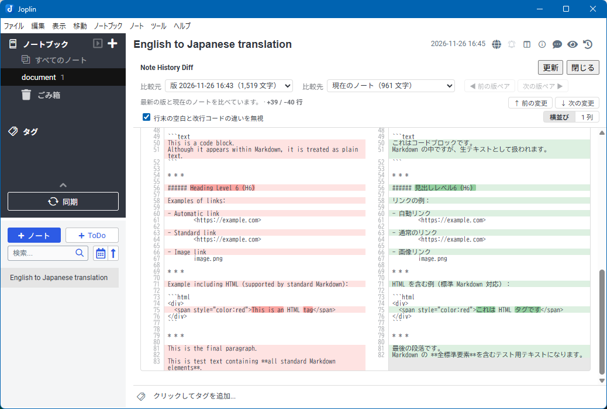
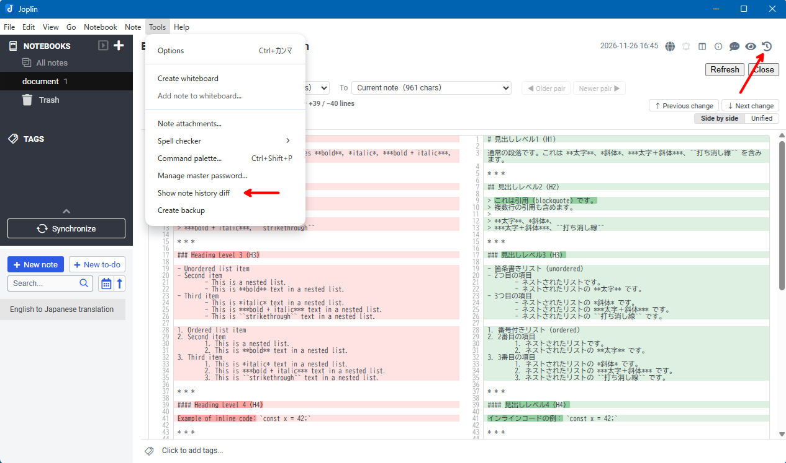
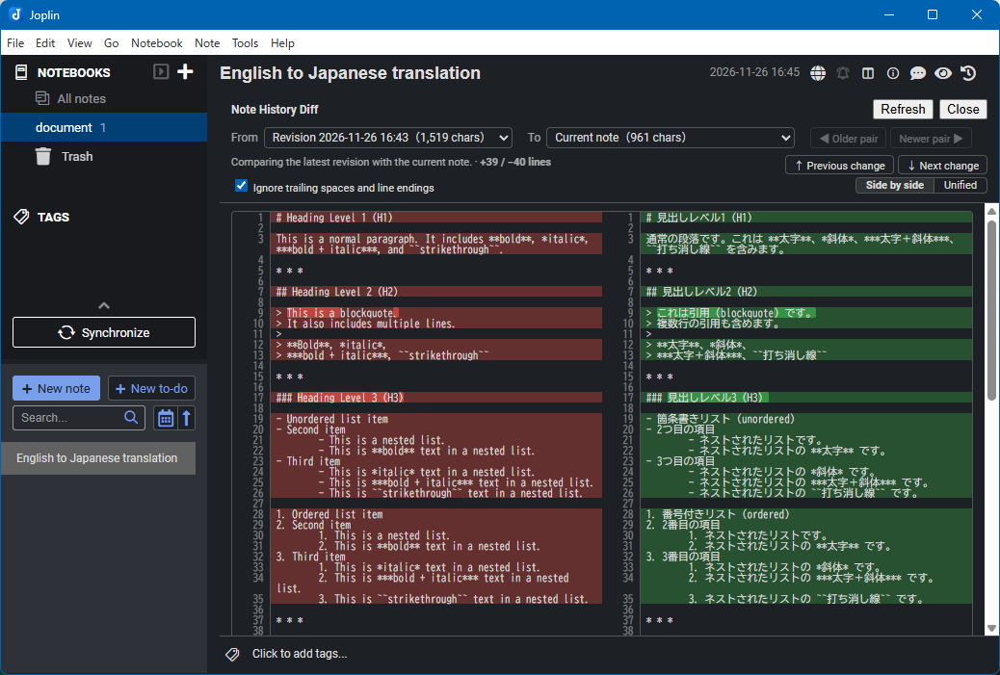

# Note History Diff

[Joplin](https://joplinapp.org/) のノートの 2 つの版を比べて、変わったところを表示するプラグインです。

Joplin はノートの履歴を保存していますが、本体の「ノートの履歴」では版を 1 つずつしか見られません。Note History Diff は、2 つの版の違い、または版と現在のノートの違いを、エディタの場所に横並びで表示します。

[English README](README.md)

ほかの画面：英語の表示、暗いテーマ

## 機能

- **好きな 2 つの版を比べる**：「比較元」「比較先」の一覧から、比べる版を選べます。一覧には、ノートのすべての版（新しい順、日時と文字数つき）と現在のノートが並びます。
- **横並びと 1 列**：2 つの表示方式を切り替えられ、選んだ方式を覚えます。表示の幅が 600 px 未満のときは、いつも 1 列で表示します。
- **文字単位の強調**：変わった行の中で、変わった文字だけを濃い色で示します。
- **履歴をたどる**：「前の版ペア」「次の版ペア」で、隣り合う版どうしの比較を 1 つずつたどれます。
- **変更箇所へ移動**：「前の変更」「次の変更」で、変更のかたまりへスクロールします。変更のない行は、前後 3 行を残して折りたたみます。
- **空白の違いを無視**：行末の空白と改行コードの違いは、最初は差分に出しません（チェックボックスで切り替え）。
- **タイトルの変更**も、本文の上に表示します。
- **読み取り専用**：ノートとその履歴を書き換えることはありません。
- 画面の文言は gettext で翻訳しており、Joplin の表示言語に従います。対応している言語（11）：英語、日本語、中国語（簡体字・繁体字）、韓国語、ドイツ語、フランス語、スペイン語、イタリア語、ポルトガル語（ブラジル）、ロシア語。日時は Joplin の「日付の形式」「時刻の形式」に従います。

## インストール

Joplin のプラグインの画面（Windows と Linux は「ツール」→「オプション」→「プラグイン」、macOS は「Joplin」→「設定」→「プラグイン」）で **Note History Diff** を検索して、インストールします。

[GitHub Releases](https://github.com/akiratamcat/joplin-plugin-note-history-diff/releases) から `.jpl` ファイルをダウンロードし、プラグインの画面の「ファイルからインストール」で入れることもできます。自分でビルドする方法は [CONTRIBUTING.ja.md](CONTRIBUTING.ja.md) を見てください。

動作環境：Joplin 3.7 以降のデスクトップ版（Windows、macOS、Linux）。モバイル版にはまだ対応していません。

## 使い方

1. ノートを開きます。
2. ノートのツールバーの履歴ボタンを押すか、「ツール」→「ノート履歴の差分を表示」を選びます。
3. Joplin 本体の「ノートの履歴」と同じように、ノートのエディタの場所に履歴の差分が表示されます。
   - 最新の版のあとにノートを編集していれば、最新の版と現在のノートを比べます。
   - 編集していなければ、最新の版とその 1 つ前の版を比べます。
4. 「閉じる」を押すか、別のノートを開くと、エディタに戻ります。

ノートのツールバーにある Joplin の「エディタの切り替え」ボタンでも、エディタと、そのノートの履歴の差分を切り替えられます。

### 知っておくとよいこと

- Joplin は、前の版から 10 分以上たってノートが変更されたときにだけ版を作り、90 日間保存します（どちらも初期値）。そのため「1 つ前の版」は、最後の編集より前の状態のことがあります。これらの設定は「ツール」→「オプション」→「ノート履歴」で変えられます。
- 履歴の差分は、メインウィンドウでだけ使えます。別ウィンドウで開いたノートの履歴は、メインウィンドウで開いて見てください。
- 履歴の差分を開いたまま Joplin を終了すると、次の起動時に一瞬だけ履歴の画面が見えてから、ふつうのエディタに戻ることがあります。

## 問題の報告

不具合、質問、要望は [Issues](https://github.com/akiratamcat/joplin-plugin-note-history-diff/issues) にお寄せください。日本語でも英語でもかまいません。セキュリティの問題は [SECURITY.ja.md](SECURITY.ja.md) を見てください。ビルドや開発への参加は [CONTRIBUTING.ja.md](CONTRIBUTING.ja.md) を見てください。

## 協力してくださった方

Note History Diff に協力してくださった皆さんに感謝します。

- [@bwat47](https://github.com/bwat47)：同期で枝分かれした履歴の不具合の報告と修正（[#2](https://github.com/akiratamcat/joplin-plugin-note-history-diff/issues/2)、[#4](https://github.com/akiratamcat/joplin-plugin-note-history-diff/pull/4)）

## ライセンス

Note History Diff は [MIT ライセンス](LICENSE)で公開しています。

プラグインのパッケージには、次のサードパーティのソフトウェアも入っています。ライセンスの全文は [THIRD_PARTY_NOTICES.ja.md](THIRD_PARTY_NOTICES.ja.md) にあり、プラグインのパッケージにも同梱しています。

| 名前 | 版 | ライセンス | Web サイト |
| ---- | -- | ---------- | ---------- |
| diff-match-patch（版の組み立てと差分の計算） | 1.0.5 | Apache-2.0 | <https://github.com/google/diff-match-patch> |

## 生成 AI の利用について

本プラグインは、生成 AI（Anthropic の Claude）を全面的に用いて開発しています。
仕様書、ソースコード、テスト、ドキュメント、翻訳のかなりの部分を Claude で作成しました。
作者が Claude の出力を逐次確認し、採用するかどうかの判断と修正を行っており、
最終的な内容の責任は作者が負います。問題を見つけた場合は Issue でお知らせください。
