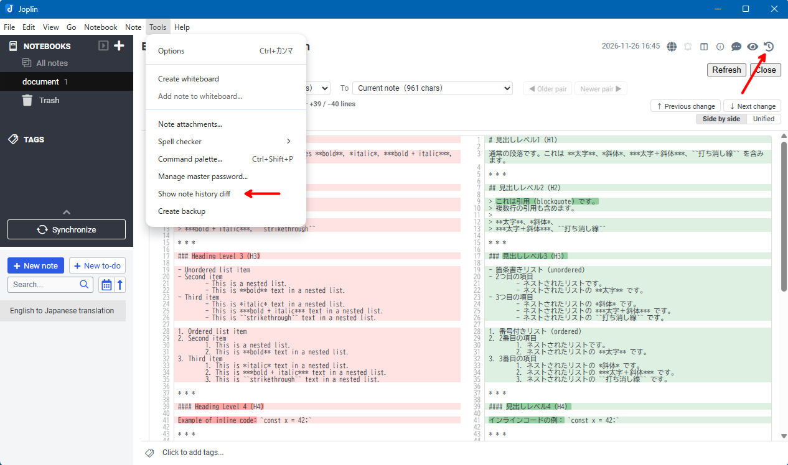
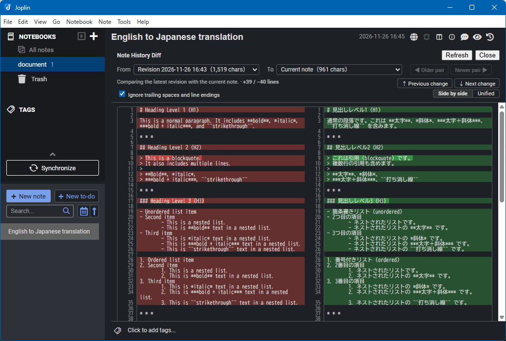
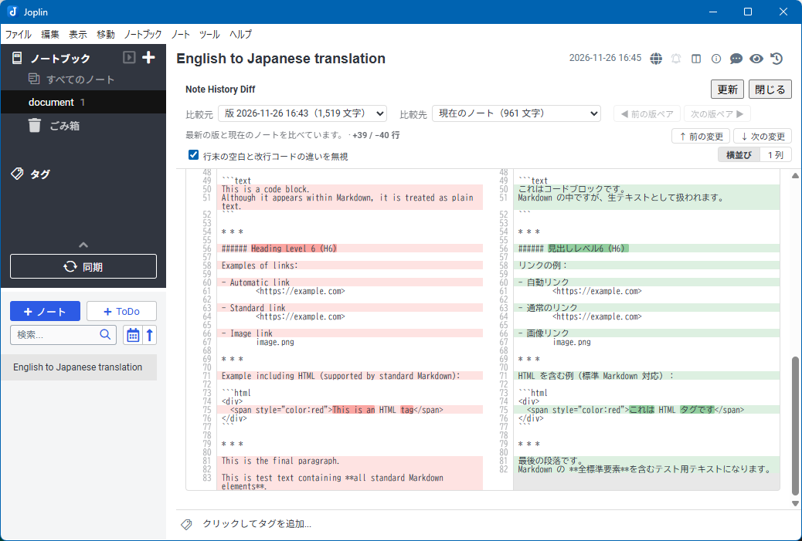

# Note History Diff

Compare two revisions of a [Joplin](https://joplinapp.org/) note and see exactly what changed.

Joplin keeps a history of your notes, but its note history view shows one revision at a time. Note History Diff shows the differences between two revisions, or between a revision and the current note, side by side, in the editor area.

日本語：[このページの後半](#日本語)（[README.ja.md](README.ja.md) と同じ内容）

More screenshots: dark theme, Japanese user interface

## Features

- **Compare any two versions**: pick the versions to compare in the **From** and **To** lists. They list every revision of the note (newest first, with its date and length) and the current note.
- **Side by side or unified**: switch between the two layouts; your choice is remembered. Narrow views (under 600px) always use one column.
- **Character highlight**: inside a changed line, the characters that changed are highlighted.
- **Step through the history**: **Older pair** / **Newer pair** compare neighbouring revisions one step at a time.
- **Jump between changes**: **Previous change** / **Next change** scroll to each block of changes. Unchanged lines are folded, keeping three lines of context.
- **Ignore whitespace**: differences in trailing spaces and line endings are ignored by default (a checkbox turns this off).
- **Title changes** are shown above the body.
- **Read only**: the plugin never changes your notes or their history.
- The user interface is translated with gettext and follows Joplin's display language. Supported languages (11): English, Japanese, Chinese (Simplified and Traditional), Korean, German, French, Spanish, Italian, Portuguese (Brazil) and Russian. Dates follow your Joplin date and time formats.

## Installation

Open Joplin's plugin screen (Tools → Options → Plugins on Windows and Linux, Joplin → Settings → Plugins on macOS), search for **Note History Diff**, and install it.

You can also download the `.jpl` file from [GitHub Releases](https://github.com/akiratamcat/joplin-plugin-note-history-diff/releases) and install it with "Install from file" on the plugin screen. To build the plugin yourself, see [CONTRIBUTING.md](CONTRIBUTING.md).

Requirements: Joplin 3.7 or later, desktop (Windows, macOS, Linux). Mobile is not supported yet.

## Usage

1. Open a note.
2. Click the history button in the note toolbar, or choose **Tools > Show note history diff**.
3. The history diff replaces the note editor, like Joplin's own note history view.
   - If you edited the note after its latest revision, the latest revision is compared with the current note.
   - Otherwise, the latest revision is compared with the one before it.
4. Click **Close**, or open another note, to return to the editor.

Joplin's "Toggle editors" button in the note toolbar also switches between the editor and the history diff of the current note.

### Good to know

- Joplin saves a revision only when a note is changed at least 10 minutes (by default) after the previous revision, and keeps revisions for 90 days (by default). The "previous" revision can therefore be older than your last edit. You can change these settings in **Tools > Options > Note History**.
- The history diff works in the main window only. For a note opened in its own window, open it in the main window to see its history.
- When Joplin starts with the history diff left open, the view may flash briefly before the normal editor comes back.

## Reporting problems

Please use the [Issues](https://github.com/akiratamcat/joplin-plugin-note-history-diff/issues) page for bugs, questions and requests. English or Japanese is fine. For security problems, see [SECURITY.md](SECURITY.md). To build the plugin or contribute, see [CONTRIBUTING.md](CONTRIBUTING.md).

## Contributors

Thank you to everyone who has contributed to Note History Diff.

- [@bwat47](https://github.com/bwat47): report and fix for revision histories branched by sync ([#2](https://github.com/akiratamcat/joplin-plugin-note-history-diff/issues/2), [#4](https://github.com/akiratamcat/joplin-plugin-note-history-diff/pull/4))

## License

Note History Diff is released under the [MIT License](LICENSE).

The plugin package also contains the third-party software below. The full license text is in [THIRD_PARTY_NOTICES.md](THIRD_PARTY_NOTICES.md), which is also included in the plugin package.

| Name | Version | License | Website |
| ---- | ------- | ------- | ------- |
| diff-match-patch (rebuilds revisions and computes the diff) | 1.0.5 | Apache-2.0 | <https://github.com/google/diff-match-patch> |

## AI-assisted development

This plugin is developed with extensive use of generative AI (Anthropic's Claude).
A large share of the specification, source code, tests, documentation, and
translations was produced with Claude. The maintainer reviews each output step by
step, decides what to adopt, and makes corrections as needed. The maintainer is
responsible for the final content. If you find a problem, please report it on the
Issues page.

---

## 日本語

<!-- The Japanese half below is generated from README.ja.md by npm run readme. Edit README.ja.md, not this part. -->
<!-- ja:start -->

[Joplin](https://joplinapp.org/) のノートの 2 つの版を比べて、変わったところを表示するプラグインです。

Joplin はノートの履歴を保存していますが、本体の「ノートの履歴」では版を 1 つずつしか見られません。Note History Diff は、2 つの版の違い、または版と現在のノートの違いを、エディタの場所に横並びで表示します。

ほかの画面：英語の表示、暗いテーマ

### 機能

- **好きな 2 つの版を比べる**：「比較元」「比較先」の一覧から、比べる版を選べます。一覧には、ノートのすべての版（新しい順、日時と文字数つき）と現在のノートが並びます。
- **横並びと 1 列**：2 つの表示方式を切り替えられ、選んだ方式を覚えます。表示の幅が 600 px 未満のときは、いつも 1 列で表示します。
- **文字単位の強調**：変わった行の中で、変わった文字だけを濃い色で示します。
- **履歴をたどる**：「前の版ペア」「次の版ペア」で、隣り合う版どうしの比較を 1 つずつたどれます。
- **変更箇所へ移動**：「前の変更」「次の変更」で、変更のかたまりへスクロールします。変更のない行は、前後 3 行を残して折りたたみます。
- **空白の違いを無視**：行末の空白と改行コードの違いは、最初は差分に出しません（チェックボックスで切り替え）。
- **タイトルの変更**も、本文の上に表示します。
- **読み取り専用**：ノートとその履歴を書き換えることはありません。
- 画面の文言は gettext で翻訳しており、Joplin の表示言語に従います。対応している言語（11）：英語、日本語、中国語（簡体字・繁体字）、韓国語、ドイツ語、フランス語、スペイン語、イタリア語、ポルトガル語（ブラジル）、ロシア語。日時は Joplin の「日付の形式」「時刻の形式」に従います。

### インストール

Joplin のプラグインの画面（Windows と Linux は「ツール」→「オプション」→「プラグイン」、macOS は「Joplin」→「設定」→「プラグイン」）で **Note History Diff** を検索して、インストールします。

[GitHub Releases](https://github.com/akiratamcat/joplin-plugin-note-history-diff/releases) から `.jpl` ファイルをダウンロードし、プラグインの画面の「ファイルからインストール」で入れることもできます。自分でビルドする方法は [CONTRIBUTING.ja.md](CONTRIBUTING.ja.md) を見てください。

動作環境：Joplin 3.7 以降のデスクトップ版（Windows、macOS、Linux）。モバイル版にはまだ対応していません。

### 使い方

1. ノートを開きます。
2. ノートのツールバーの履歴ボタンを押すか、「ツール」→「ノート履歴の差分を表示」を選びます。
3. Joplin 本体の「ノートの履歴」と同じように、ノートのエディタの場所に履歴の差分が表示されます。
   - 最新の版のあとにノートを編集していれば、最新の版と現在のノートを比べます。
   - 編集していなければ、最新の版とその 1 つ前の版を比べます。
4. 「閉じる」を押すか、別のノートを開くと、エディタに戻ります。

ノートのツールバーにある Joplin の「エディタの切り替え」ボタンでも、エディタと、そのノートの履歴の差分を切り替えられます。

#### 知っておくとよいこと

- Joplin は、前の版から 10 分以上たってノートが変更されたときにだけ版を作り、90 日間保存します（どちらも初期値）。そのため「1 つ前の版」は、最後の編集より前の状態のことがあります。これらの設定は「ツール」→「オプション」→「ノート履歴」で変えられます。
- 履歴の差分は、メインウィンドウでだけ使えます。別ウィンドウで開いたノートの履歴は、メインウィンドウで開いて見てください。
- 履歴の差分を開いたまま Joplin を終了すると、次の起動時に一瞬だけ履歴の画面が見えてから、ふつうのエディタに戻ることがあります。

### 問題の報告

不具合、質問、要望は [Issues](https://github.com/akiratamcat/joplin-plugin-note-history-diff/issues) にお寄せください。日本語でも英語でもかまいません。セキュリティの問題は [SECURITY.ja.md](SECURITY.ja.md) を見てください。ビルドや開発への参加は [CONTRIBUTING.ja.md](CONTRIBUTING.ja.md) を見てください。

### 協力してくださった方

Note History Diff に協力してくださった皆さんに感謝します。

- [@bwat47](https://github.com/bwat47)：同期で枝分かれした履歴の不具合の報告と修正（[#2](https://github.com/akiratamcat/joplin-plugin-note-history-diff/issues/2)、[#4](https://github.com/akiratamcat/joplin-plugin-note-history-diff/pull/4)）

### ライセンス

Note History Diff は [MIT ライセンス](LICENSE)で公開しています。

プラグインのパッケージには、次のサードパーティのソフトウェアも入っています。ライセンスの全文は [THIRD_PARTY_NOTICES.ja.md](THIRD_PARTY_NOTICES.ja.md) にあり、プラグインのパッケージにも同梱しています。

| 名前 | 版 | ライセンス | Web サイト |
| ---- | -- | ---------- | ---------- |
| diff-match-patch（版の組み立てと差分の計算） | 1.0.5 | Apache-2.0 | <https://github.com/google/diff-match-patch> |

### 生成 AI の利用について

本プラグインは、生成 AI（Anthropic の Claude）を全面的に用いて開発しています。
仕様書、ソースコード、テスト、ドキュメント、翻訳のかなりの部分を Claude で作成しました。
作者が Claude の出力を逐次確認し、採用するかどうかの判断と修正を行っており、
最終的な内容の責任は作者が負います。問題を見つけた場合は Issue でお知らせください。

<!-- ja:end -->
