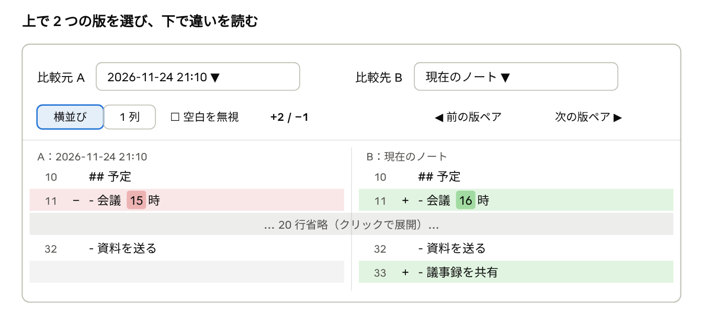
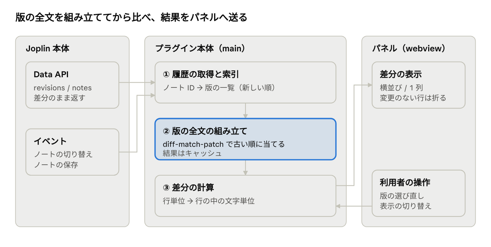

# Note History Diff 仕様書

2026-11-27 時点

> 原本は Claude Docs 上の文書です。この Markdown はその書き出しで、図は画像に置き換えています。

## 1. 概要

Note History Diff は、Joplin のノート履歴から 2 つの版を選び、その差分を色分けして表示するデスクトップ版プラグインです。最初の版（MVP）では「今のノートと 1 つ前の版を 1 クリックで比べる」ことを目標にします。v1 のゴールはデスクトップ版の正式リリース（公式プラグイン一覧に掲載され、Joplin 本体のプラグイン検索で見つかる状態。8 章）で、モバイル版への対応は将来に行います（F16）。

### 背景と課題

Joplin 本体の履歴画面では、過去の版を 1 つずつ開いて読むことしかできません。今の版と 1 つ前の版のどこが違うのかは、自分で目で見比べるしかありません。

### 目的

- 2 つの版の違い（追加・削除・変更）がひと目で分かるようにする
- 変更をたどって「いつ、何が変わったか」を調べやすくする
- 必要な部分だけを過去の版に戻せるようにする（次の段階）

### 想定する利用者

- 長い文書やメモを少しずつ書き直していく人
- 同期のあとで内容が意図せず変わっていないか確かめたい人
- 誤って消した文章を過去の版から探したい人

### 類似プラグインとの違い

2026-11-25 時点の調査では、履歴の版どうしを比べられるプラグインは見つかりませんでした。フォーラムでは 2022 年から同じ要望が出ていますが、本体にも実装されていません。

| 名前 | 比べる対象 | 履歴の版を比べられるか |
| --- | --- | --- |
| [Diff view](https://joplinapp.org/plugins/plugin/io.github.personalizedrefrigerator.diff-view/) | 今のノートと別のノート | できない |
| [History Panel](https://github.com/alondmnt/joplin-plugin-history-panel) | ノートを開いた順番（閲覧履歴） | 対象外 |
| **Note History Diff（本プラグイン）** | 同じノートの 2 つの版 | できる |

今は、古い版を「復元」して Diff view で比べれば差分を見られます。ただし手間がかかり、「Restored Notes」フォルダに不要なノートも増えます。本プラグインはこの手間をなくします。

## 2. 前提：Joplin の履歴の仕組みと制約

Joplin は履歴を「前の版との差分」として保存しています。そのためプラグインは、古い順に差分を当てて各版の全文を組み立て直す必要があります（[履歴の仕様](https://joplinapp.org/help/dev/spec/history)）。

| 項目 | 内容 | 本プラグインへの影響 |
| --- | --- | --- |
| 保存の形 | 版ごとに、タイトルと本文はテキストの差分（`title_diff` / `body_diff`）、そのほかの項目は変わった項目だけ（`metadata_diff`）を持つ。テキストの差分は `patch_make` の結果を JSON にした文字列で、変化がなければ `[]`（検証で確認）。版どうしは `parent_id` でつながる。 | 全文を得るには、`diff-match-patch` で差分を古い順に当てる処理を自分で書く。 |
| 版が作られる間隔 | 前の版から一定時間（初期値 10 分）が過ぎて保存されたときだけ作られる。版には、その時点（`item_updated_time`）のノートの内容が入る（検証で確認）。 | 「1 つ前の版」は直前の編集ではなく、数十分〜数日前の状態のことがある。画面で版の日時をはっきり見せる。 |
| 保存期間 | 初期値 90 日。過ぎた版は消える。 | 古い版がないことを前提にする。履歴が 0 件のときの表示を用意する。 |
| 履歴機能のオン・オフ | 利用者が設定で履歴を無効にできる。 | 無効のときはそのことを画面で伝える。この設定はプラグインから読める（検証で確認）。 |
| Data API | `revisions` があり、差分の形でデータを返す（[フォーラム](https://discourse.joplinapp.org/t/data-api-new-route-to-get-past-version-of-a-note/47342)）。ある版の全文を直接返す機能は本体にない。 | ノート ID では絞り込めない（検証で確認）。全件を読んでノートごとの索引を作る（7 章 R1）。 |
| 本体の履歴画面 | プラグインからボタンなどを足せない。 | diff 画面はプラグイン独自のエディタビューとして、エディタの場所に作る。 |

## 3. 機能要件

「段階」は実装の目標時期で、MVP、次の段階（v1 までに作る）、v1 の後、将来の 4 つです（F8 は取りやめ）。MVP は F1〜F5 の 5 つで、「2 つの版を選んで差分を読める」ところまでを作ります。「実装状況」は 2026-11-27 時点で、実装済みのものには最初に入った公開版を書きます。

| ID | 段階 | 実装状況 | 機能 | 内容 |
| --- | --- | --- | --- | --- |
| F1 | MVP | 実装済（1.0.0） | 1 つ前の版と比較 | コマンドかツールバーボタン 1 つで、エディタの場所に、今のノート本文と最新の版の差分を表示する（4 章）。版にはその時点のノートの内容が入るため、版ができてから編集していなければ 2 つは同じになる（検証で確認）。同じときは、最新の版とその 1 つ前の版を比べる。 |
| F2 | MVP | 実装済（1.0.0） | 任意の 2 つの版を比較 | 版の一覧から「比較元 A」と「比較先 B」を選ぶ。一覧には日時と文字数を出し、「現在のノート」も選べるようにする。日時は Joplin の「日付の形式」「時刻の形式」に従う。読み込めない版は選べない。 |
| F3 | MVP | 実装済（1.0.0） | 表示方式の切り替え | 横並び（side-by-side）と 1 列（unified）を切り替える。前回選んだ方式を記憶する。表示の幅が狭いとき（目安 600 px 未満）は自動で 1 列にする（検証で確認）。大きなダイアログで開く機能は将来（F15）。 |
| F4 | MVP | 実装済（1.0.0） | 行単位＋文字単位の強調 | 変わった行を色付けし、その行の中で変わった文字をさらに強調する。非常に長い行や大きな変更では行単位だけにする（6 章）。 |
| F5 | MVP | 実装済（1.0.0） | タイトルの差分 | タイトルが変わっていれば、本文の上に差分を表示する。 |
| F6 | 次の段階 | 実装済（1.0.0） | 前後の版へ移動 | 「前の版ペア」「次の版ペア」ボタンで、版 n と n-1 の比較を順にたどる。離れた 2 つの版を選んでいるときの「前の版ペア」は、比較先の版で終わる組になる。 |
| F7 | 次の段階 | 実装済（1.0.0） | 変更箇所へジャンプ・折りたたみ | 「前の変更」「次の変更」ボタンで、変更のかたまりへスクロールする。変更のない行は、前後 3 行を残して「… 変更のない 42 行 …」のように折りたたむ（折りたたみは MVP で実装）。 |
| F8 | 取りやめ | 実装しない | 変更の統計 | 「+12 行 / −3 行」を表示する。版の一覧にも小さく出す。2026-11-26 に不要と判断（差分の上の「+n / −n 行」は MVP で表示済み）。 |
| F9 | 次の段階 | 実装済（1.0.0） | 空白・改行コードの違いを無視 | 行末の空白・タブと改行コード（CRLF、CR）だけの違いを差分に出さない。チェックボックスで切り替え、初期値は有効。 |
| F10 | v1 の後 | 未実装 | 部分的に元に戻す | 比較先が「現在のノート」のときだけ使える。差分の塊（hunk）ごとに、現在のノートのその部分だけを比較元の内容に戻す。書き換えるのは現在のノートだけで、履歴（版）は変えない。実行前に必ず確認ダイアログを出す。編集中で保存していない内容があるときの扱いは R6（7 章）。 |
| F11 | 将来 | 未実装 | 差分の書き出し | unified diff 形式でクリップボードへコピーする。新しいノートとしても保存できる。 |
| F12 | 取りやめ | 実装しない | レンダリング後の比較 | Markdown を表示した状態で差分を見せる。2026-11-27 に取りやめ（Markdown 記法のままのほうが、違いを見分けやすいため）。 |
| F13 | 将来 | 未実装 | メタデータの差分 | ToDo の完了状態、作成元 URL などの変化を表示する。 |
| F14 | v1 の後 | 未実装 | 設定画面 | 初期の表示方式、変更の前後に残す行数、文字単位の強調のオン・オフ、履歴画面の文字の大きさ（フォントサイズ。利用者の要望、2026-11-26）を設定できる。 |
| F15 | 将来 | 未実装 | 大きなダイアログ・別ウィンドウでの表示 | 表示の幅が狭いときでも横並びで見られるように、同じ差分を大きなダイアログで開く。MVP から移した（2026-11-25）。エディタの場所に表示するようになり幅の問題がほぼ解消し、その形でテストを重ねてきたため、v1 の後に回し（2026-11-26）、さらに将来に回した（2026-11-27）。ノートを別ウィンドウで開いたときに、そのウィンドウで履歴を表示すること（v1 はメインウィンドウだけ。4 章）も、ここで合わせて扱う（2026-11-27）。 |
| F16 | 将来 | 未実装 | モバイル版 | Joplin のモバイル版（Android、iOS）で使えるようにする。画面が狭く横並び表示も合わないため、1 列の表示を基本にする（6 章）。「v1 で対象外にするもの」から移した（2026-11-27）。 |

### MVP の受け入れ条件

- 履歴が 2 件以上あるノートで、F1 の操作をすると差分が表示される
- 本体の履歴画面でその版を開いたときの本文と、プラグインが組み立てた本文が一致する
- 比較元 A・比較先 B を選び直すと、差分がその 2 つの版のものに切り替わる（F2）
- 表示方式を切り替えると、Joplin を再起動したあともその方式で開く。表示の幅が狭いときは 1 列になる（F3）
- 1 行の中で 1 語だけ変えたとき、行が色付けされ、変えた語だけが濃く強調される（F4）
- タイトルだけを変えた版を比べると、タイトルの差分が出て、本文は「変更なし」と表示される（F5）
- 履歴が 0 件・1 件のノートで、理由を書いたメッセージが出て、エラーにならない
- 履歴の表示中に別のノートを開くと、元のエディタに戻る。「閉じる」でも戻る
- MVP ではノートを書き換えない（読み取り専用）

### 対応しないもの

- 履歴そのものの編集・削除と、手動で版を作ること
- 削除済みノートの履歴の表示
- 添付ファイルや画像の中身の比較。本文中のリンク（`:/リソースID`）は、文字列として差分に出るだけ

## 4. 画面仕様

差分は、Joplin 本体の「ノートの履歴」と同じように、エディタの場所に表示します（エディタビュー）。表示中はノートの編集画面と入れ替わり、「閉じる」で元のエディタに戻ります。横に置くパネルは使いません（2026-11-26 に決定。検証の経緯は `docs/prototype.md`）。表示の幅が足りないとき（600 px 未満）は 1 列表示にします（F3）。横並びを大きなダイアログで開く機能は、将来加えます（F15）。

上の段で比べる 2 つの版を選び、中の段で表示を切り替え、下の段で差分を読みます。濃い色の部分は、行の中で変わった文字（F4）です。画面の上には「再読み込み」と「閉じる」のボタンも置きます（図では省略）。

### 操作の入口

| 入口 | 動き |
| --- | --- |
| コマンド「ノート履歴の差分を表示」 | エディタの場所に履歴を表示し、F1（今のノートと最新の版）で比べる |
| エディタのツールバーボタン | 上と同じ |
| メニュー「ツール」 | 上と同じ |
| キーボードショートカット | 上と同じ。MVP では初期のキーを割り当てず、利用者が Joplin のキーボード設定で割り当てる |
| Joplin の「エディタの切り替え」ボタン | 上と同じ。もう一度押すと元のエディタに戻る。エディタビューの仕組み上、メインウィンドウのふつうのノートと ToDo で常に表示される（利用者が了承済み） |

### 表示の動き

- 「閉じる」を押すか別のノートを開くと、元のエディタに戻る。本体の「ノートの履歴」と同じく、履歴の表示はノートごとに終わる
- 表示したまま Joplin を終了しても、次の起動時はふつうのエディタで開く。このとき一瞬、履歴の画面が見えることがある。Joplin が前回の表示を復元してからプラグインが戻すためで、プラグインでは防げない（制約）
- 履歴を表示するのはメインウィンドウだけ。ノートを別ウィンドウで開いたときは、そのウィンドウに「エディタの切り替え」ボタンを出さず、履歴ボタンやメニューでは「メインウィンドウでだけ使える」と案内する（2026-11-26 に決定。別ウィンドウへの対応は将来。F15 と合わせて扱う）
- ほかのエディタ系プラグイン（エディタビューを使うもの）と同時に入れても動く（v0.3.1 で確認）
- 版の一覧は、その版の時点でのノートの更新時刻（`item_updated_time`）で新しい順に並べ、各行にその日時と文字数を出す。版が作られた時刻は、この更新時刻より遅れることがあるため、並べ替えには使わない
- 履歴が 0 件のときは「このノートには履歴がありません」と、履歴の保存条件（10 分間隔・90 日保存）を表示する
- 履歴機能が無効のときは、そのことと設定の場所を表示する
- 組み立てに時間がかかるときは、読み込み中の表示を出す
- 長い差分は、表示の中で縦にスクロールする
- 横並びの表示で範囲選択してコピーすると、選択を始めた側（比較元か比較先）の文字だけを、1 行ずつ改行でつないでコピーする。行番号、行がない側の空き、折りたたんだ行は入れない。選択できるのも、その側だけ（Issue #1、v1.0.1）。1 列の表示では、表示の順にコピーする（「+」「−」の記号は入らない）

## 5. 技術設計

プラグイン本体が履歴を読んで版の全文を組み立て、差分を計算します。エディタビュー（webview）は受け取った結果を表示するだけにします。いちばん難しく、本体と結果がずれると困るのは ② の組み立てです。

履歴を表示するときと「再読み込み」のときは ① からやり直します。版を選び直したとき（F2）は、キャッシュした全文を使って ③ だけをやり直します。エディタビューから本体へは `postMessage` で操作を伝え、本体は `setHtml` で結果を描きます。

### エディタビューの開け閉め

エディタビュー API には次の制約があり、それぞれ下のように対処します（検証版 v0.3.0〜v0.3.7 で確認、2026-11-26）。

| 制約 | 対処 |
| --- | --- |
| 有効かどうかの確認（`onActivationCheck`）は、ノートの切り替えや起動のときにしか呼ばれない。同じノートのまま有効にし直せず、`showEditorPlugin` は有効なビューしか出せない | すべてのノートで「有効」と答え、ふだんは隠しておく。履歴を出すときは `showEditorPlugin`、戻すときは `toggleEditorPlugin` を使う |
| Joplin は開いていたビューを設定 `plugins.shownEditorViewIds` に覚え、ノートの切り替えや再起動のあとに自動で開き直す | 起動時とノートの切り替え時にこの設定を読む。ビューが入っていたときだけ、その直後の表示（ノートの切り替えは 2 秒以内）を「自動で開いた」とみなして元のエディタに戻す。それ以外の表示は「エディタの切り替え」ボタンの操作として、そのノートの履歴を出す |
| 隠れているビューには `onUpdate` が来ない。同じノートで表示し直しても来ないことがある。隠すと webview は破棄される | webview 側のスクリプトが、表示されたこと（大きさが 0 でなくなったこと）を `shown` メッセージで本体に知らせる。本体は `onUpdate` と `shown` のうち先に来たほうで処理する |
| 元のエディタに戻せないことがある | 戻す前に「読み込み中」を描き、1 回だけ再試行する。それでも戻らなければ、そのノートの履歴を表示する |
| エディタビューは、ノートのエディタがあるウィンドウごとに作られる（別ウィンドウで開いたノートにも作られる）。メインウィンドウのビューが最初に作られ、ハンドルの末尾が -default になる（Joplin 本体のソースで確認） | ハンドルでメインウィンドウのビューを見分け、それだけを使う。ほかのビューは「無効」と答える。ノートの切り替えは、メインウィンドウのビューへの onActivationCheck で知る |

### モジュール構成

| モジュール | 役割 | 使うもの |
| --- | --- | --- |
| `RevisionRepository` | 履歴を読んで、ノート ID ごとの版の一覧を作る | `joplin.data.get` |
| `RevisionRebuilder` | 差分を古い順に当てて、各版のタイトルと本文を組み立てる | `diff-match-patch` |
| `RevisionCache` | 組み立てた全文を版 ID ごとにメモリに保持する。全版は持たず、表示中の 2 版と一定間隔の版（チェックポイント）だけを持ち、ほかの版は近くのチェックポイントから組み立て直す（100 版すべてを持つと数百万〜数千万文字になるため）。上限を超えたら、最近使っていないものから捨てる。上限は件数と合計サイズの両方で決め、値は検証の結果で決める | ― |
| `DiffEngine` | 行単位と文字単位の差分を計算し、表示用のデータにする | `diff-match-patch` |
| `EditorViewController` | エディタビューの登録、表示と非表示の制御、ノートの切り替えの監視、メッセージのやり取り | `joplin.views.editors`、`joplin.workspace` |
| `ui/`（webview 側） | 差分データを HTML で描く。ボタンの操作と、表示されたこと（shown）を本体へ伝える | ― |

### 主な Joplin API

- `joplin.data.get(['revisions'], ...)`：履歴の取得（ノート ID では絞り込めない。R1）
- `joplin.workspace.selectedNote()` / `onNoteSelectionChange()` / `onNoteChange()`：今のノートとその変化
- `joplin.views.editors.register()` / `setHtml()` / `onUpdate()` / `onMessage()` / `isVisible()`：エディタビューとそのやり取り
- コマンド `showEditorPlugin` / `toggleEditorPlugin`：エディタビューの表示と、元のエディタへの切り替え
- `joplin.commands.register()`、`joplin.views.toolbarButtons.create()`、`joplin.views.menuItems.create()`：操作の入口
- `joplin.settings`：表示方式などの設定の保存と、本体の設定（履歴機能、`plugins.shownEditorViewIds`）の読み取り

### ライブラリ

- **diff-match-patch**：Joplin 本体と同じライブラリ。版の組み立てには必須で、差分の計算にも使う。差分は、まず各行を 1 文字に置き換えて行単位で比べ（line mode）、次に変わった行だけを文字単位で比べる。計算の打ち切り時間（`Diff_Timeout`、初期値 1 秒）を過ぎると差分が最小にならず見づらくなるため、値は検証で調整する。
- **表示**：MVP では自前の HTML で描く。機能が増えたら、Diff view プラグインが使う `@codemirror/merge` や `diff2html` への切り替えを検討する。
- 開発の土台は Joplin 公式のプラグイン生成ツール（`yo joplin`）で作る。

## 6. 非機能要件と対象環境

対象は Joplin デスクトップ版だけです。v1 のゴールはデスクトップ版のリリースです。モバイル版は画面が狭く、横並び表示も合わないため、将来対応します（F16）。

| 項目 | 要件 |
| --- | --- |
| 対象アプリ | Joplin デスクトップ版（Windows / macOS / Linux）。最小バージョンは開発開始時に使う API に合わせて決める。 |
| エディタ | Markdown エディタとリッチテキストエディタのどちらでも使える。差分は保存された Markdown の文字列で比べる。 |
| 速さ | 版が 100 件あるノートでも、F1 の操作から差分が出るまで 2 秒以内を目標にする（検証で見直す）。 |
| 大きなノート | 本文が大きいときは、文字単位の強調を止めて行単位だけにする。文字単位で比べるのは、変更のあった行の組のうち最初の 2,000 組まで。それより多い組、1 行 5,000 文字を超える行、変わった文字が 7 割を超える行は、行全体の色だけにする。行単位の差分の打ち切り時間は 1 秒のまま（17,000 行でも 138 ms で届かない。v0.5.0、5 章）。 |
| 安全性 | MVP ではノートと履歴を書き換えない。F10 の導入後も、書き換えるのは今のノート本文だけで、履歴には触れない。 |
| 外部通信 | しない。データはすべて手元の Joplin の中で扱う。 |
| テーマ | Joplin のライト・ダークテーマに合わせて配色を変える。追加・削除は色だけでなく `+` / `−` の記号でも示す。 |
| 表示言語 | 11 言語（英語、日本語、中国語簡体字・繁体字、韓国語、ドイツ語、フランス語、スペイン語、イタリア語、ポルトガル語（ブラジル）、ロシア語）。dg-plantuml などと同じ gettext（PO ファイル）で翻訳し、Joplin の表示言語に従う（2026-11-26）。利用者向けの文書は英語と日本語の併記。 |
| ライセンス | MIT（予定）。`diff-match-patch` は Apache-2.0 で、MIT のプラグインに組み込んで使える（ライセンスの表記を同梱する）。ほかのライブラリも、追加するときに確かめる。 |

## 7. リスクと未確認事項、進め方

最大のリスクは、Data API で「ノート 1 件分の履歴」を効率よく取れるかどうかです。本実装の前に、小さな検証用プラグインで確かめます。

### リスクと未確認事項

| ID | 内容 | 影響 | 対策（代わりの案） |
| --- | --- | --- | --- |
| R1 | `revisions` をノート ID で絞り込めない（検証で確定） | 全件をページ送りで読むことになり、履歴が多いと遅い | 起動後に一度だけ全件を読んで「ノート ID → 版の一覧」の索引を作り、その後は差分だけ読む |
| R2 | 組み立てた本文が、本体の表示と一致しない | 差分の結果が信用できない | 本体の `RevisionService` と同じ手順で組み立てる。本体との照合テストを用意する |
| R3 | 版の数が多いノートで組み立てが遅い | 画面が固まる | 組み立て自体は速い（100 版で 15〜114 ms）。問題はメモリで、全版の本文を持たず、表示中の 2 版と一定間隔の版（チェックポイント）だけを持つ |
| R4 | 暗号化（E2EE）を使っているときに、復号前の版が混じるかもしれない | 一部の版を組み立てられない | 復号されていない版は一覧で「未復号」と表示し、比較の対象から外す |
| R5 | 将来の Joplin で履歴の保存形式が変わる | 動かなくなる | 組み立て処理を 1 か所にまとめ、変わったらそこだけ直す |
| R6 | F10 で部分的に戻すとき、エディタで編集中の保存していない内容とぶつかる | 利用者が入力した内容が消える、または戻した内容が上書きされる | 書き換えの前にノートを保存させるか、編集中は F10 を使えなくする。書き換えの方法（Data API で本文を更新するか、エディタのコマンドで置き換えるか）は F10 の着手時に検証して決める |

### 検証計画（本実装の前に行う）

検証用プロトタイプ（`docs/prototype.md`）を Joplin 3.7.24 で実行した結果です（2026-11-25、v0.1.1〜v0.1.3）。

- [x] `joplin.data.get(['revisions'])` で履歴が取れるか → 取れる。1 ページ最大 100 件で、`has_more` でページ送りする（300 件・4 ページを 72〜80 ms）
- [x] ノート ID（`item_id`）で絞り込めるか（R1）→ できない。`item_id` を指定しても無視され、`notes/<id>/revisions` は Not Found
- [x] 版の本文を組み立てられるか（R2）→ できる（v0.1.2）。差分は JSON 形式。5 件すべて成功し、最後の版が今のノートと完全に一致したため、途中の版も正しく組み立てられていると判断する。`parent_id` のつながりも一致
- [x] 最新の版と今のノートの関係（F1）→ 版にはその時点のノートの内容が入る。版ができてから編集していなければ、最新の版と今のノートは同じ（今回はタイトル・本文とも一致）
- [x] プラグインから履歴機能の設定を読めるか（2 章）→ 読める（有効 `true`、保存 90 日、作成間隔 600000 ms）
- [x] 版が多いノートでの処理時間（R3）→ 問題ない（v0.1.3）。2,600 行のノートから 100 版の模擬履歴を作り、Joplin 内で組み立て 15 ms・全件成功。17,000 行では Joplin 外で 114 ms。ただし全版の本文を持つと、100 版で約 600 万文字（2,600 行）〜約 4,000 万文字（17,000 行）になるため、全版は持たない（R3、5 章）
- [x] 大きな本文での差分の速さと打ち切り時間 → 2,600 行・約 6 万文字で 11 ms（Joplin 内）、17,000 行・約 39 万文字で 110 ms（Joplin 外）。どちらも `Diff_Timeout`（1 秒）には届かない
- [x] 表示の幅に応じた表示の切り替え（F3）→ できる。600 px 以上で横並び、未満で 1 列に CSS だけで切り替わる。段落の一部だけの変更も行全体が色付けされ、行末の空白だけの変更も変更として出るため、F4（文字単位の強調）と F9（空白の無視）が必要
- [ ] 17,000 行の差分をエディタの場所に表示したときの快適さ（渡す HTML は約 1.6 MB）
- [ ] 大きなダイアログで横並び表示を開けるか（F15。将来確かめる）

### 進め方

1. **検証**：上の検証計画を済ませ、R1〜R3 の対策を決める
2. **MVP**：F1〜F5 を作り、受け入れ条件を満たす（2026-11-26 に完了。v0.6.0 で受け入れ条件 9 項目をすべて確認）
3. **次の段階**：F6・F7・F9（表示と移動の使いやすさ）を足す
4. **部分的に戻す**：F10 は v1 の後に回す（2026-11-26 に決定）。ノートを書き換えるので、単独でテストしてから公開する
5. **v1 リリース（ゴール）**：8 章の条件を満たして npm に公開し、公式プラグイン一覧と Joplin 本体の検索に出ることを確かめてから、[要望のフォーラム](https://discourse.joplinapp.org/t/side-by-side-difference-view-for-note-history/26461)で知らせる（2026-11-26 に v1.0.0 を npm と GitHub に公開。同日、公式一覧に掲載され、Joplin 本体の検索で見つかることを確認。v1 達成。フォーラムの Plugins カテゴリに紹介を投稿し、翌 11-27 に公開された（https://discourse.joplinapp.org/t/note-history-diff-compare-two-revisions-of-a-note-side-by-side/51706 ））
6. **v1 の後**：F10（部分的に戻す）、F14（設定画面）に対応する。F11・F13・F15・F16（モバイル版）は将来、F12 は取りやめ（2026-11-27）。将来の機能は、利用者の声を見て順番を決める

## 8. v1（正式リリース）の条件

v1 は、公式プラグイン一覧（[joplinapp.org/plugins](https://joplinapp.org/plugins/)）に掲載され、Joplin 本体の「プラグイン」画面の検索で見つかる状態を指します。掲載に審査はなく、条件を満たして npm に公開すると自動で一覧に取り込まれます（[公式の開発ガイド](https://cdn.jsdelivr.net/npm/generator-joplin@3.7.2/generators/app/templates/GENERATOR_DOC.md)）。

### 掲載の仕組み

1. `npm publish` で npm に公開する
2. 公式リポジトリのスクリプトが条件に合うパッケージを取り込む。リポジトリは 30 分ごとに更新される（[joplin/plugins](https://github.com/joplin/plugins)）
3. Joplin 本体はこのリポジトリから一覧を読み込み、検索・インストール・更新に使う（[公式リポジトリ開設の告知](https://discourse.joplinapp.org/t/official-joplin-plugin-repository-is-now-ready-if-you-are-developing-a-plugin-please-read-on/13635)）

npm に公開した時点で一覧に載るため、v1 より前の試用版は npm には出しません。`.jpl` ファイルを GitHub Releases などで配り、手動でインストールしてもらいます。うっかり公開しないように、v1 までは `package.json` に `"private": true` を入れておきます（この状態だと `npm publish` は失敗する）。

### 公開の条件（チェックリスト）

- [x] npm アカウント（[akiratamcat](https://www.npmjs.com/~akiratamcat)）で `npm login` する
- [x] `package.json` の `name` が `joplin-plugin-` で始まる（名前：`joplin-plugin-note-history-diff`。2026-11-25 時点で npm では未使用）
- [x] `package.json` の `keywords` に `joplin-plugin` を含む。`"private": true` を外してある
- [x] `npm run dist` で `publish/` に `.jpl` と `.json` ができている
- [x] `manifest.json` の必須項目（`manifest_version`、`name`、`version`、`app_min_version`）を埋める。`version` は `1.0.0` にし、`npm run updateVersion` で `package.json` とそろえる
- [x] GitHub の公開リポジトリ（予定：`https://github.com/akiratamcat/joplin-plugin-note-history-diff`）に push し、`repository_url` と `homepage_url` をそこに向ける。スクリーンショットを相対パスで載せるには、どちらかが GitHub を指している必要がある
- [x] `README.md` と `LICENSE`（MIT）を置く
- [x] 公開後、npm のキーワード検索、公式プラグイン一覧、Joplin 本体の検索の 3 か所で見つかることを確かめる（2026-11-26：公式一覧への掲載と、Joplin 本体の検索・インストールを確認。npm の検索と公式サイトのプラグインのページは、索引の反映待ち）

2026-11-26 に v1.0.0 を公開した（npm の `joplin-plugin-note-history-diff@1.0.0`、GitHub Releases の v1.0.0 に `.jpl` を添付）。公開前に、利用者向けの文書を英日併記にし、UI を gettext で 11 言語にした。

### manifest.json の主な項目

項目と使われ方は[マニフェストの仕様](https://joplinapp.org/help/api/references/plugin_manifest)によります。

| 項目 | 設定する値（案） | 使われ方 |
| --- | --- | --- |
| `id` | `io.github.akiratamcat.note-history-diff` | プラグインを見分ける ID。公開後は変えない（推測：公式リポジトリのフォルダ名にも使われている） |
| `name` | Note History Diff | 画面に表示される名前 |
| `description` | 英語の 1 文（例：Compare two revisions of a note and see what changed.） | 一覧と検索結果に表示される |
| `keywords` | history, revision, diff, compare, version | 検索に使われる |
| `categories` | `viewer`（`productivity` も検討） | 一覧のカテゴリ |
| `platforms` | `["desktop"]` | 省略してもデスクトップ扱い。モバイル対応のときに `mobile` を足す |
| `app_min_version` | 開発開始時に決める | 対応する Joplin の最小バージョン |
| `screenshots` | 差分画面（エディタの場所） | 公式サイトの一覧に表示される |
| `icons` | PNG の 16 / 32 / 48 / 128 px | 一覧のアイコン。省略すると既定のアイコン |
| `promo_tile` | 440 × 280 px（任意） | 公式サイトのトップページに使われる |

### 一覧から外れる場合

- 動かなくなった、保守されていない、より良いプラグインに置き換えられた、などの理由で「obsolete」にされると、検索に出なくなる（[obsoletes](https://github.com/joplin/plugins/blob/master/readme/obsoletes.md)）
- 悪意のある版と判断されると、その版は「blocked」になり、インストールできなくなる（[blocked](https://github.com/joplin/plugins/blob/master/readme/blocked.md)）
- 公式の「Recommended」の印は、今は審査の仕組みがなく、Joplin チームやよく貢献する人のプラグインだけに付いている。v1 の条件には含めない（[recommended](https://github.com/joplin/plugins/blob/master/readme/recommended.md)）
